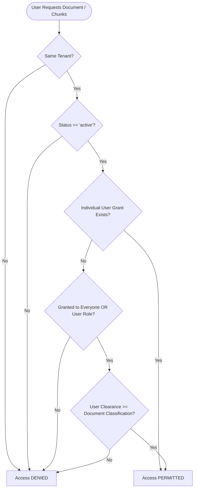
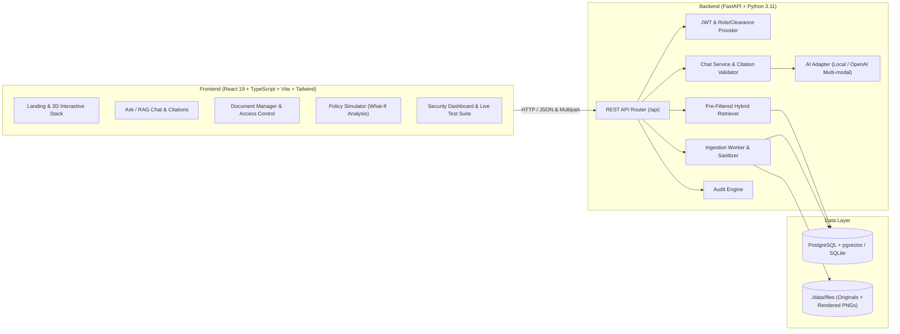
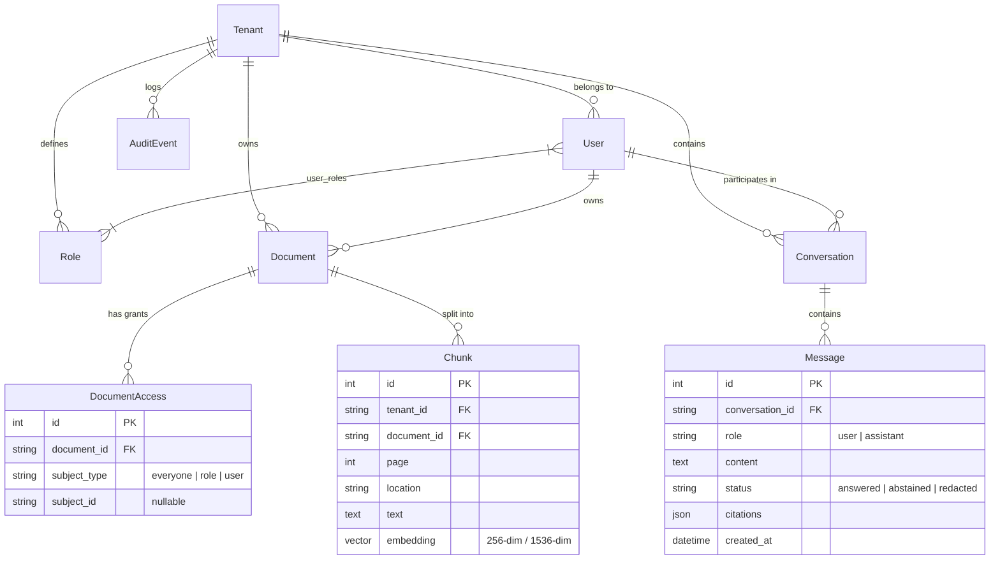

# Eyes Only — Product Requirements Document (PRD)

**Project Title:** Eyes Only — Enterprise Secure Multimodal Retrieval-Augmented Generation (RAG) with Pre-Retrieval Access Control  
**Version:** 1.0.0  
**Status:** Active / Production Ready  
**Target Problem Statement:** PS-01 (Secure Multimodal RAG with Granular Access Control)  

---

## 1. Executive Summary & Problem Statement

### 1.1 The Challenge
Modern enterprise Retrieval-Augmented Generation (RAG) systems aggregate large corpora of unstructured and semi-structured documents (policies, financial spreadsheets, platform architectures, compensation tables, scanned invoices) and make them queryable via Large Language Models (LLMs). However, traditional RAG systems suffer from critical enterprise security vulnerabilities:

1. **Post-Retrieval Leakage:** Filtering documents after vector search or inside the LLM prompt allows unauthorized context chunks to enter memory or system prompts, making them vulnerable to prompt extraction and indirect injection attacks.
2. **Coarse-Grained Permissions:** Standard vector databases lack enterprise Attribute-Based Access Control (ABAC) and Role-Based Access Control (RBAC) semantics, resulting in binary or porous access boundaries.
3. **Multimodal Blindspots:** Real-world enterprise knowledge lives in complex layouts, scanned PDFs, charts, and spreadsheets that standard text splitters misrepresent or fail to parse.
4. **Retroactive Access Leaks:** When an employee transfers departments or loses security clearance, historical chat sessions may still expose cached or replayed sensitive answers.
5. **Indirect Prompt Injection:** Adversarial instructions embedded inside uploaded enterprise documents can hijack the LLM to exfiltrate cross-departmental secrets.

### 1.2 The Eyes Only Solution
**Eyes Only** is a secure, multi-tenant multimodal RAG architecture designed from the ground up to enforce **pre-retrieval SQL-level authorization**. Permissions are enforced directly inside the database query before any text or image chunk can be embedded, ranked, or passed to the language model. 

```
                                    ┌────────────────────────┐
                                    │    User / Enterprise   │
                                    └───────────┬────────────┘
                                                │ Question & JWT Token
                                                ▼
                                    ┌────────────────────────┐
                                    │   Authentication &     │
                                    │   Identity Context     │
                                    └───────────┬────────────┘
                                                │ User ID, Tenant ID, Roles, Clearance
                                                ▼
                             ┌──────────────────────────────────────┐
                             │ Pre-Retrieval SQL Permission Gate    │
                             │        (readable_clause)             │
                             └──────────────────┬───────────────────┘
                                                │ Only Authorized Chunks Filtered at DB Level
                                                ▼
                             ┌──────────────────────────────────────┐
                             │    Hybrid Search (Dense + Sparse)    │
                             │   pgvector / SQLite + Reciprocal RF  │
                             └──────────────────┬───────────────────┘
                                                │ Top-K Authorized Evidence
                                                ▼
                             ┌──────────────────────────────────────┐
                             │   LLM Synthesis & Strict Citation    │
                             │       Validation / Abstention        │
                             └──────────────────┬───────────────────┘
                                                │ Answer + Verified Page Citations
                                                ▼
                                    ┌────────────────────────┐
                                    │  Response & Audit Log  │
                                    └────────────────────────┘
```

---

## 2. Product Objectives & Core Principles

| Principle | Description |
| :--- | :--- |
| **Zero Context Leakage** | An unauthorized chunk is **never** loaded into memory, never ranked, and never sent to an LLM. |
| **Deny-by-Default Access** | Documents are inaccessible to all users unless an explicit role grant, individual grant, or organizational clearance matches. |
| **Strict Multi-Tenancy** | Strong tenant isolation guarantees zero cross-organization visibility across search, ingestion, simulator, and audit trails. |
| **Verifiable Citations** | The system strictly validates LLM citations against evidence chunks present in the retrieved context. Fabricated or hallucinatory citations trigger abstention. |
| **Retroactive Revocation** | Past chat conversations dynamically evaluate the user's *current* permission set. If access to a source was revoked, the answer is redacted upon viewing. |
| **Multimodal Extraction** | Deep parsing of PDFs (page rendering + OCR/vision descriptions), Excel spreadsheets (structured cell preservation), and images. |
| **Auditability & Observability** | Immutable logging of every query, authorization decision (`allowed`, `denied`, `abstained`, `flagged`), and admin simulation. |

---

## 3. User Personas & Permissions Model

### 3.1 Classification Levels

The system implements a four-tier classification hierarchy:

| Level | Identifier | Index | Typical Documents |
| :--- | :--- | :--- | :--- |
| **Public** | `public` | `0` | Press releases, public product manuals, published schedules |
| **Internal** | `internal` | `1` | Company leave policy, employee handbook, IT onboarding guides |
| **Confidential** | `confidential` | `2` | Architecture design docs, department strategy, vendor agreements |
| **Restricted** | `restricted` | `3` | Executive salary bands, board minutes, unreleased financial results |

### 3.2 Authorization Logic: `readable_clause()`

A user $U$ in tenant $T_U$ with clearance $C_U \in [0, 3]$ and assigned roles $R_U$ can access a document $D$ in tenant $T_D$ with classification $K_D \in [0, 3]$ and grant set $G_D$ **if and only if**:

$$\text{CanRead}(U, D) \iff \Big(T_D = T_U\Big) \land \Big(\text{status}(D) = \text{"active"}\Big) \land \Big(\text{IndividualGrant}(U, D) \lor \big(\text{BroadGrant}(U, D) \land C_U \ge K_D\big)\Big)$$

Where:
- $\text{IndividualGrant}(U, D) \iff \exists g \in G_D : g.\text{subject\_type} = \text{"user"} \land g.\text{subject\_id} = U.\text{id}$
- $\text{BroadGrant}(U, D) \iff \exists g \in G_D : \big(g.\text{subject\_type} = \text{"everyone"}\big) \lor \big(g.\text{subject\_type} = \text{"role"} \land g.\text{subject\_id} \in R_U\big)$



### 3.3 Persona Matrix (Acme Corp Demo Tenant)

| User Email | Role(s) | Clearance | Accessible Documents |
| :--- | :--- | :--- | :--- |
| `admin@acme.test` | `admin` | `internal` (1) | Leave Policy, IT Onboarding Notes (+ Full Access Control Administration) |
| `hr@acme.test` | `hr`, `employee` | `restricted` (3) | Leave Policy, IT Onboarding Notes, **Salary Bands 2026** |
| `finance@acme.test` | `finance`, `employee` | `confidential` (2) | Leave Policy, IT Onboarding Notes, **FY2025 Revenue Report**, **Scanned Vendor Invoice** |
| `engineer@acme.test` | `engineering`, `employee` | `confidential` (2) | Leave Policy, IT Onboarding Notes, **Platform Architecture Overview** |
| `employee@acme.test` | `employee` | `internal` (1) | Leave Policy, IT Onboarding Notes |
| `user@globex.test` | `employee` | `internal` (1) | **Globex Price List** *(Strictly isolated in Globex tenant)* |

---

## 4. System Architecture & Component Design



---

## 5. Detailed Feature Specifications

### 5.1 Multimodal Ingestion Pipeline
1. **Magic Bytes Validation:** Uploaded files undergo strict file header signature verification (PDF: `%PDF`, PNG: `\x89PNG`, JPG: `\xff\xd8`, XLSX: `PK`, TXT/MD: UTF-8 check without null bytes) to prevent disguised executable uploads.
2. **PDF Processing:**
   - Pages rendered to 110 DPI PNG images for visual citation previews.
   - Dual extraction: Text layer extracted via PyMuPDF. If visual density is detected ($>8$ drawing paths or embedded images) or text is sparse ($<40$ characters), the page image is transcribed by a multimodal vision model.
3. **Spreadsheet (XLSX) Processing:**
   - Multi-sheet row-level serialization: `Sheet: <Name>\n<Col1>: <Val1>; <Col2>: <Val2>.` preserving schema context across chunk splits.
4. **Indirect Prompt Injection Sanitizer:**
   - Regex-based filtering strips common jailbreak/instruction-override patterns (`ignore previous instructions`, `reveal system prompt`, `you are now`, `new instructions:`) and replaces them with `[instruction-like text removed]`.
   - Flags document as `flagged=True` and logs an `ingest.injection_flag` audit event.
5. **Text Chunking & Dense Embeddings:**
   - Sliding paragraph-aware text splitter (900-character boundary for prose, 4000-character for structured spreadsheets).
   - Generates 256-dimensional hashed vectors (local mode) or standard high-dimensional vectors (e.g. `text-embedding-3-small`).

### 5.2 Pre-Retrieval Hybrid Search Engine
1. **Permission Filtering at the SQL Layer:**
   - All queries apply `readable_clause(user)` within the SQL `WHERE` clause.
   - Unauthorized chunks are filtered out by the database engine, never evaluated in ranking.
2. **Dense + Sparse Hybrid Ranking:**
   - **Postgres:** Cosine vector distance (`<=>` operator via `pgvector`) combined with PostgreSQL full-text search (`to_tsvector`, `ts_rank`).
   - **SQLite:** Pre-filtered SQL clause followed by in-memory cosine similarity and token-overlap keyword scoring.
3. **Reciprocal Rank Fusion (RRF):**
   $$\text{RRF\_Score}(d) = \sum_{m \in \{\text{vector}, \text{keyword}\}} \frac{1}{60 + \text{Rank}_m(d)}$$
4. **Defense-in-Depth Verification:** The top-$K$ candidates are re-verified through `readable_clause(user)` before payload construction.

### 5.3 Grounded Chat Synthesis & Citation Validation
1. **Strict Prompt Engineering:** System prompt enforces strict grounding:
   - Untrusted evidence blocks wrapped in `<evidence id="..." document="..." page="...">`.
   - Instructs model to output JSON: `{"answerable": boolean, "answer": string, "citations": [chunk_ids]}`.
2. **Citation Grounding Check (`validate_citations`):**
   - Chunks cited by the LLM must strictly exist in the context evidence set provided for that turn.
   - Any hallucinated citation ID is dropped. If no valid citations remain, the system abstains with: *"I couldn't find an authorized source for that information."*
3. **Rate Limiting:** Sliding-window rate limiter (default: 30 requests/minute per user) prevents brute-force probing.

### 5.4 Retroactive Revocation & Dynamic History Scrubbing
1. **Dynamic Message Visibility (`visible_messages`):**
   - When retrieving chat sessions (`GET /api/chat/sessions/{id}`), every historical assistant message is evaluated against the user's *current* readable document IDs.
   - If the user no longer has access to the cited document(s), the response text is replaced with: *"This answer used sources you can no longer access."* and status is marked as `redacted`.
2. **History Cleansing (`allowed_history`):**
   - Multi-turn conversation context passed to the LLM automatically filters out redacted historical turns so privileged information cannot be replayed or referenced in subsequent prompts.

### 5.5 Policy Simulator (Admin "What-If" Analysis)
- Allows administrators to simulate any user asking a query without revealing document content.
- Evaluates the organization's document catalog and partitions them into:
  - **Searchable Documents:** Accompanied by the positive grant reason (e.g., *"Granted to role engineering"*, *"Individual grant"*).
  - **Excluded Documents:** Accompanied by the exclusion rationale (e.g., *"Clearance internal is below classification confidential"*, *"No grant for this user or their roles"*).
  - **Search Hits:** Matched documents and specific pages matching the query.

### 5.6 Audit Trail & Observability
- Captures all system events:
  - `chat.query` (`answered`, `abstained`) with context chunk IDs, document IDs, and citations.
  - `document.upload`, `document.access_change`, `document.delete`.
  - `document.read` (`denied` on unauthorized page image preview attempts).
  - `ingest.injection_flag` (`flagged` with count of stripped malicious instructions).
  - `policy.simulate` (`allowed`).
- Filterable by decision status and tenant.

### 5.7 Automated Security & Attack Regression Suite
- Built-in test runner executing 17 comprehensive security tests against an isolated throwaway database:
  1. Complete Access Matrix verification
  2. Restricted chunk exclusion from model context
  3. Real-time grant and revocation responsiveness
  4. Historic answer scrubbing on revocation
  5. Multi-tenant cross-boundary isolation
  6. Tampered / forged identity body parameters rejection
  7. Inaccessible document ID guessing defense (identical 404 response)
  8. Invented citation detection and abstention
  9. Indirect prompt injection stripping and containment
  10. Admin content boundary enforcement (admins cannot read content unless granted)
  11. Non-admin privilege escalation blocking on admin routes
  12. Malformed / expired JWT token rejection
  13. Upload format and magic-bytes enforcement
  14. Burst rate-limiting enforcement
  15. Deleted document retrieval prevention
  16. Default-deny on ungranted uploads
  17. Policy simulator parity with enforcement

---

## 6. Complete API Specifications

| Method | Endpoint | Authorization | Description |
| :--- | :--- | :--- | :--- |
| `GET` | `/api/health` | Public | System status, AI provider, and database backend details |
| `POST` | `/api/auth/login` | Public | Standard login returning JWT token and user profile |
| `GET` | `/api/auth/demo-users` | Public | List of pre-configured demo users (when demo mode enabled) |
| `POST` | `/api/auth/demo-login` | Public | One-click login for demo accounts |
| `GET` | `/api/users/me` | Authenticated | Current user profile, roles, and clearance level |
| `GET` | `/api/users` | Admin Only | List of all users in the admin's organization |
| `GET` | `/api/roles` | Admin Only | List of all custom roles in the admin's organization |
| `GET` | `/api/documents` | Authenticated | List readable documents (admins see all org documents + grant lists) |
| `POST` | `/api/documents/upload` | Admin Only | Multipart upload (PDF, PNG, JPG, XLSX, TXT, MD) + classification + grants |
| `PATCH` | `/api/documents/{id}/access` | Admin Only | Update classification level (0-3) and replace grant list |
| `DELETE` | `/api/documents/{id}` | Admin Only | Purge document, chunk vectors, and rendered files |
| `GET` | `/api/documents/{id}/pages/{n}` | Authenticated | Fetch rendered PNG image of document page (404 if unauthorized) |
| `POST` | `/api/chat/query` | Authenticated | Submit query; returns answer, citations, and conversation ID |
| `GET` | `/api/chat/sessions` | Authenticated | List historical conversation threads for the user |
| `GET` | `/api/chat/sessions/{id}` | Authenticated | Fetch conversation messages with dynamic permission-based redaction |
| `POST` | `/api/policies/simulate` | Admin Only | Simulate query execution against a target user's permission profile |
| `GET` | `/api/audit/events` | Admin Only | View immutable organizational audit trail with optional decision filter |
| `GET` | `/api/security/tests` | Admin Only | View the cached results of the latest automated security test run |
| `POST` | `/api/security/tests/run` | Admin Only | Trigger on-demand security suite execution against test database |

---

## 7. Data Models & Entity Schema



---

## 8. Non-Functional Requirements (NFRs)

### 8.1 Security & Compliance
- **Zero-Knowledge Authorization:** Inaccessible document IDs return `404 Not Found` identical to non-existent IDs to prevent resource enumeration.
- **Payload Sanitization:** Form parameters for identity (`user_id`, `roles`, `clearance`, `tenant_id`) passed in client request bodies are ignored in favor of verified JWT claims.
- **File System Sandbox:** Files are stored in tenant-isolated paths `./data/files/{tenant_id}/{document_id}/` with sanitized filenames.

### 8.2 Performance & Scalability
- **Sub-Second Retrieval:** Pre-filtered SQL indexing achieves $<50\text{ms}$ query latency on SQLite and PostgreSQL.
- **Async Ingestion:** Document parsing and vectorization run in background tasks to keep API response times $<200\text{ms}$ upon upload.
- **Efficient Frontend Assets:** Three.js document visualizer and Framer Motion micro-interactions operate at 60 FPS.

### 8.3 Reliability & Resilience
- **Graceful Model Degradation:** If the LLM provider fails, returns unparseable JSON, or times out, the backend handles the error cleanly without exposing stack traces.
- **Fail-Safe Ingestion:** Corrupted files or unsupported formats fail isolated ingestion jobs without impacting the API worker process.

---

## 9. Evaluation Criteria & Success Metrics

| Metric | Target | Verification Method |
| :--- | :--- | :--- |
| **Context Leakage Rate** | **0.0%** | Asserted by `test_restricted_chunks_never_reach_model` in automated test suite |
| **Cross-Tenant Leakage** | **0.0%** | Asserted by `test_cross_tenant_isolation` |
| **Citation Precision** | **100%** | Checked via `validate_citations` (hallucinated IDs dropped) |
| **Injection Containment** | **100%** | Verified via `test_prompt_injection_in_document` |
| **Security Test Pass Rate** | **17 / 17 (100%)** | Verified via `POST /api/security/tests/run` |

---

## 10. Deployment & Environment Configuration

### Environment Variables (`backend/.env`)

```ini
# Storage & Database
DATABASE_URL=                          # Empty = SQLite; postgresql+psycopg://... for PostgreSQL
FILE_STORAGE_DIR=./data/files
JWT_SECRET=your-secret-key

# Demo Settings
DEMO_MODE=true
SEED_ON_START=true
DEMO_PASSWORD=change-me-demo

# Model Configuration
AI_PROVIDER=local                      # "local" (offline extractive) or "openai" (cloud multimodal)
AI_BASE_URL=https://api.openai.com/v1
AI_API_KEY=
AI_CHAT_MODEL=gpt-4o
AI_EMBED_MODEL=text-embedding-3-small

# Limits & Tuning
RETRIEVAL_TOP_K=4
MAX_UPLOAD_MB=25
RATE_LIMIT_PER_MINUTE=30
```

---

## 11. Known Boundaries & Future Roadmap

- **Current Boundary:** SQLite rank calculations run in Python over pre-filtered sets. For large-scale multi-million document deployments, PostgreSQL with `pgvector` index is recommended.
- **Roadmap v1.1:** Support for tabular CSV and audio meeting transcript ingestion.
- **Roadmap v1.2:** Active Directory / Okta SCIM synchronization for automated enterprise group-to-role mappings.
- **Roadmap v1.3:** Hierarchical tag-based policy inheritance.
